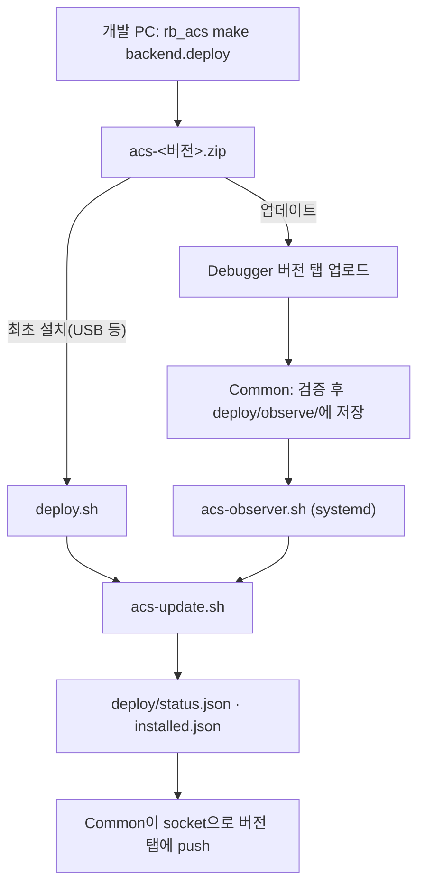

# ACS 배포 키트

인터넷이 없는 현장 PC(Linux amd64)에 RB ACS를 설치하고, Debugger 버전 탭에서 올린 릴리즈 ZIP으로 업데이트하는 스크립트 묶음입니다.
구성과 흐름은 `rainbow-deploy-kit/muscat`(설치 → 상시 observer → 업데이트 엔진)을 따릅니다.

## 전체 흐름



1. 개발 PC(인터넷 가능, linux/amd64)의 rb_acs 저장소에서 `make backend.deploy`를 실행해 질문에 답합니다.
   - 배포 종류: 정식 릴리즈(origin 마지막 `vX.Y.Z` 태그에서 patch·minor·major로 올려 태그·push) 또는 시험 빌드
   - 업데이트 서비스: 전체 또는 바뀐 서비스만
   - 결과: 개발 PC `~/acs-release/`에 `acs-<버전>-install.zip`(처음 설치용, 이미지 포함)과 `acs-<버전>-update.zip`(업데이트용).
     Slack을 설정했으면 배포 알림과 함께 업데이트 ZIP이 채널 스레드에 올라갑니다.
2. 현장 PC에 이 키트와 ZIP을 가져가 `deploy.sh`로 설치합니다.
3. 이후 업데이트는 브라우저에서 `http://<현장PC>:13000/state/debugger/` → **Version** 탭 → ZIP 업로드로 합니다. 인터넷이 필요 없습니다.

## 설치

```bash
git clone https://github.com/rainbow-mobile/acs_deploy_kit.git ~/acs_deploy_kit   # 또는 USB로 복사
cd ~/acs_deploy_kit
./deploy.sh ~/acs-v1.2.3-install.zip --frs-url=http://192.168.0.10:3000 --moms-url=http://192.168.0.20:8080
```

| 옵션 | 기본값 | 설명 |
|---|---|---|
| `--root=<디렉터리>` | 키트 옆 `rb-acs` (예: `~/rb-acs`) | 설치 디렉터리 |
| `--project=<이름>` | `rb-acs` | compose 프로젝트 이름 |
| `--gateway-url=<주소>` | `http://127.0.0.1:13000` | 업데이트 전 실행 중 Task 확인에 쓰는 Gateway 주소 |
| `--site-env=<파일>` | 없음 | 현장 설정 파일을 그대로 복사 |
| `--frs-url`, `--moms-url` | ZIP의 예시 값 | `site.env`를 새로 만들 때 넣을 FRS·MOMS 주소 |
| `--site-compose=<파일>` | 없음 | 현장 compose 덮어쓰기(`compose.site.yml`). 포트 변경 등. 업데이트해도 바뀌지 않음 |
| `--no-systemd` | 등록함 | observer systemd 등록·docker 부팅 자동 시작을 건너뜀(시험용) |

`deploy.sh`가 하는 일:

1. arch(amd64)·Docker·Compose v2.24 이상·python3·curl·flock 확인. Docker가 없고 인터넷이 되면 apt로 설치를 시도합니다.
2. `/etc/rainbow/acs-env.conf`에 설치 디렉터리·프로젝트·Gateway 주소를 적습니다(observer가 root로 읽음).
3. `site.env`가 없으면 ZIP의 `site.env.example`로 만들고 `POSTGRES_PASSWORD`를 무작위로 채웁니다(설치 후 바꾸지 않음).
4. `acs-update.sh --install`로 이미지 load, 설정·서비스 bin 배치, `compose up`, 헬스체크를 합니다.
5. docker 부팅 자동 시작과 observer(`acs-update-observer`) systemd 등록. 컨테이너는 `restart: unless-stopped`라 부팅 때 함께 뜹니다.

## 설치 디렉터리

```text
~/rb-acs/
  compose.yml, compose.offline.yml   릴리즈가 바꾸는 compose 설정
  compose.site.yml                   현장 덮어쓰기(선택, 업데이트가 건드리지 않음)
  .env                               서비스 포트와 Gateway·Zenoh 이미지 태그(릴리즈가 씀)
  site.env                           현장 값(DB 비밀번호, FRS·MOMS 주소). 업데이트가 건드리지 않음
  api-gateway/, zenoh-router-acs/    Gateway·Zenoh 설정. api-gateway/servers/*.conf는 현장 파일이라 없을 때만 놓음
  services/<서비스>/<서비스>.amd64.bin  서비스 실행 파일(컨테이너가 디렉터리를 읽기 전용 마운트)
  deploy/                            업데이트 디렉터리(Common 컨테이너 /app/deploy)
    observe/                         버전 탭이 올린 ZIP
    status.json · installed.json · observer.json · update.log
    failed/                          적용에 실패한 ZIP(최근 3개)
  backups/<시각>-<버전>/              업데이트 직전 DB 백업(최근 3개)
  deploy/archives/                   업데이트 직전 보관본(acs-rollback-*.zip, 버전 탭에서 되돌리기·삭제)
  .rollback/                         직전 업데이트 전 설정·bin
```

## 업데이트 엔진(acs-update.sh)

| 단계 | 내용 | 실패하면 |
|---|---|---|
| wait_tasks | Gateway로 Task 실행 목록을 보고 끝나지 않은 실행이 있으면 대기 | 종료 코드 75, ZIP을 두고 다시 시도 |
| validate | ZIP 풀기, 매니페스트 종류·형식·arch, 모든 파일 sha256, site.env·서비스 bin 빠짐 확인 | 아무것도 바꾸지 않음 |
| images | 이미지 tar가 있으면 `docker load`, compose가 쓰는 이미지가 모두 있는지 확인 | 아무것도 바꾸지 않음 |
| backup | `mongodump`·`pg_dump`로 `backups/`에 백업 | 아무것도 바꾸지 않음 |
| snapshot | 바뀔 서비스의 현재 bin·설정을 `deploy/archives/acs-rollback-<이전>-before-<새>-<시각>.zip`으로 보관 | 아무것도 바꾸지 않음 |
| runtime | 설정 파일 교체(이전 파일은 `.rollback/`) | 되돌림 |
| swap | 서비스 bin을 같은 디렉터리 안에서 rename으로 교체 | 되돌림 |
| restart | `compose up -d` 후 바뀐 서비스(설정이 바뀌었으면 Gateway·Zenoh router) 재시작 | 되돌림 |
| health | 모든 ACS 서비스가 healthy가 될 때까지 대기(기본 180초) | 되돌림 |

- 이미지가 없는 ZIP은 설치된 이미지 태그를 그대로 씁니다. 처음 설치는 이미지가 든 ZIP이어야 합니다.
- 보관본(`deploy/archives/`)은 업데이트 ZIP과 같은 형식이라 그대로 다시 적용하면 그 버전으로 되돌아갑니다. Debugger Version 탭
  "보관된 이전 버전"에서 버전·서비스별 버전을 보고 **되돌리기**·**삭제**합니다(자동으로 지우지 않음). 되돌릴 때도 직전 상태가 다시 보관됩니다.
  `.rollback/`은 실패했을 때 바로 되돌리는 직전 한 단계용입니다.
- DB는 자동으로 되돌리지 않습니다(마이그레이션은 앞으로만 감). 필요하면 `backups/`의 백업으로 복구합니다.
- 버전 탭의 "실행 중인 Task가 있어도 바로 적용"·"강제 적용"은 `observe/<이름>.zip.force` 표시를 남겨 wait_tasks를 건너뜁니다.
- 종료 코드: 0 완료, 75 대기, 1 실패, 2 사용법 오류.

## 운영 명령

```bash
./acs-ctl.sh status              # 설치 버전·업데이트 상태·컨테이너 상태
./acs-ctl.sh restart task        # 서비스 재시작(생략 시 전체)
./acs-ctl.sh logs task -f        # 컨테이너 로그
./acs-ctl.sh update acs-v1.2.4.zip [--force]   # observer를 거치지 않고 바로 적용
./acs-ctl.sh observer-log        # deploy/update.log 마지막 100줄
journalctl -u acs-update-observer -f
./reset.sh [--purge]             # 컨테이너·observer 제거(--purge는 DB 볼륨·설치 디렉터리까지)
```

## 테스트

```bash
bash tests/test-update-engine.sh
```

가짜 `docker`·`curl`로 설치, 부분 업데이트, 현장 파일 보존, sha256 불일치, 실행 중 Task 대기·강제 적용, 헬스체크 실패 롤백,
이미지 누락, observer 동작을 확인합니다. 실제 컨테이너는 띄우지 않습니다.

## 지금 지원하지 않는 것

- arm64(rb_acs `rb_acs_sdk` 네이티브 모듈이 x86_64뿐), Windows
- 인터넷 저장소(S3 등)에서 받아오는 온라인 업데이트. 지금은 현장 업로드만 합니다
- 관측 스택(Grafana·Loki 등). 필요하면 rb_acs `make offline-bundle` 묶음을 씁니다
